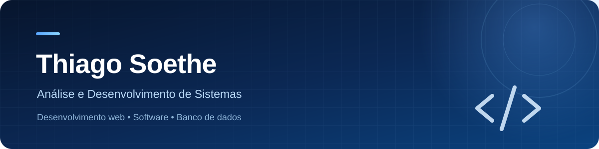

  

   

  

    Estudante de <strong>Análise e Desenvolvimento de Sistemas</strong>, construindo uma base sólida 
    em desenvolvimento web, software e banco de dados.
  

  
  
  
  

---

## Sobre mim

Sou **Thiago Soethe**, de Joinville (SC), e estou em transição de carreira para a área de tecnologia. Minha trajetória inclui formação técnica em Química pelo SENAI e experiência na indústria, na Tupy. Atualmente curso Análise e Desenvolvimento de Sistemas no UniSENAI.

Desenvolvo meus conhecimentos por meio de estudos e projetos acadêmicos, com interesse especial em **desenvolvimento de software**, **desenvolvimento web**, **banco de dados** e novas tecnologias. Busco minha primeira oportunidade profissional em TI para aprender com uma equipe, contribuir com responsabilidade e evoluir continuamente.

## Formação acadêmica

| Formação | Instituição | Situação |
| --- | --- | --- |
| Análise e Desenvolvimento de Sistemas | UniSENAI | Em andamento — conclusão prevista para 2027 |
| Técnico em Química | SENAI | Concluído |

## Experiência

**Tupy S.A.** · Joinville/SC · mar. 2022 – jul. 2026 
Aprendiz Industrial → Controlador de Expedição I. Controle de expedição, organização de processos e trabalho em equipe em ambiente industrial.

## Tecnologias e ferramentas

  
    
  
    
  

 

Essas tecnologias fazem parte da minha formação e dos meus projetos acadêmicos. Meu foco atual é consolidar os fundamentos e ampliar a experiência prática com aplicações web, APIs e bancos de dados relacionais.

## Projetos em destaque

### [FisioLife](https://github.com/thiagosoethe/FisioLife)

Sistema web acadêmico para gestão de clínicas de fisioterapia, com agenda, prontuário, financeiro e relatórios. O repositório público apresenta as telas, a arquitetura e a documentação do projeto; o código-fonte é privado.

`PHP 8.2` `MySQL / MariaDB` `Bootstrap 5.3` `JavaScript`

### [Estoque Fácil](https://github.com/UnisenaiJoinville/ADS-2025-02-Desenvolvimento-Web/tree/main/PROJETOS/Thiago-Soethe-Paschoal/projeto-docker-nodejs)

Sistema de gestão de estoque com API REST, autenticação com JWT, controle de produtos, categorias e movimentações, dashboard com gráficos e relatórios. Configurado para rodar em containers com Docker Compose, incluindo ambiente de produção.

`Node.js` `Express` `MySQL` `Docker` `Tailwind CSS` `JWT`

### Monitoramento de Fundição · Indústria 4.0 *(em andamento)*

Protótipo de monitoramento industrial: sensores simulados publicam dados via MQTT (broker EMQX), o Node-RED processa as mensagens em uma instância AWS EC2 e um dashboard exibe os indicadores em tempo real.

`MQTT` `EMQX` `Node-RED` `AWS EC2`

### [NexaShop · Consultas SQL](https://github.com/daivishow/tarefa-banco-daivison-thiago)

Análise de indicadores de negócio de um e-commerce fictício com consultas SQL: agregações, agrupamentos, filtros, `CASE` e cálculos com datas. Projeto em dupla.

`MySQL` `SQL`

### [Todas as Trilhas](https://github.com/thiagosoethe/todas_trilhas)

Coleção de atividades práticas desenvolvidas durante o curso de ADS. Reúne exercícios de front-end, uma trilha progressiva de Node.js e Express (rotas, APIs REST, CRUD) e atividades de Vue.js.

`HTML` `CSS` `JavaScript` `Node.js` `Express` `Vue.js`

### [Portfólio Web](https://github.com/thiagosoethe/thiagosoethe.github.io)

Portfólio pessoal responsivo com fundo animado em canvas, efeito de digitação, linha do tempo, filtro de projetos e animações ao rolar a página, publicado com GitHub Pages.

`HTML` `CSS` `JavaScript` · [Acessar o site](https://thiagosoethe.github.io/)

  <a href="https://github.com/thiagosoethe?tab=repositories">Ver todos os repositórios →</a>

## Estatísticas do GitHub

  <picture>
    <source media="(prefers-color-scheme: dark)" srcset="https://github-readme-stats.vercel.app/api?username=thiagosoethe&show_icons=true&locale=pt-br&hide_border=true&rank_icon=github&theme=github_dark">
    <source media="(prefers-color-scheme: light)" srcset="https://github-readme-stats.vercel.app/api?username=thiagosoethe&show_icons=true&locale=pt-br&hide_border=true&rank_icon=github&theme=default">
    
  </picture>
  <picture>
    <source media="(prefers-color-scheme: dark)" srcset="https://github-readme-stats.vercel.app/api/top-langs/?username=thiagosoethe&layout=compact&locale=pt-br&hide_border=true&theme=github_dark">
    <source media="(prefers-color-scheme: light)" srcset="https://github-readme-stats.vercel.app/api/top-langs/?username=thiagosoethe&layout=compact&locale=pt-br&hide_border=true&theme=default">
    
  </picture>

As estatísticas são geradas a partir dos repositórios públicos e podem não representar todo o tempo de estudo dedicado a cada tecnologia.

## Objetivos profissionais

Busco uma **primeira oportunidade na área de Tecnologia da Informação**, em estágio ou posição de entrada, na qual eu possa:

- aplicar os fundamentos aprendidos no curso em desafios reais;
- colaborar com desenvolvimento web, software ou banco de dados;
- aprender boas práticas com profissionais mais experientes;
- crescer de forma consistente, com organização, dedicação e responsabilidade.

## Contato e links profissionais

  
  
  

---

  Em constante aprendizado e aberto a conexões com pessoas e empresas da área de tecnologia.

